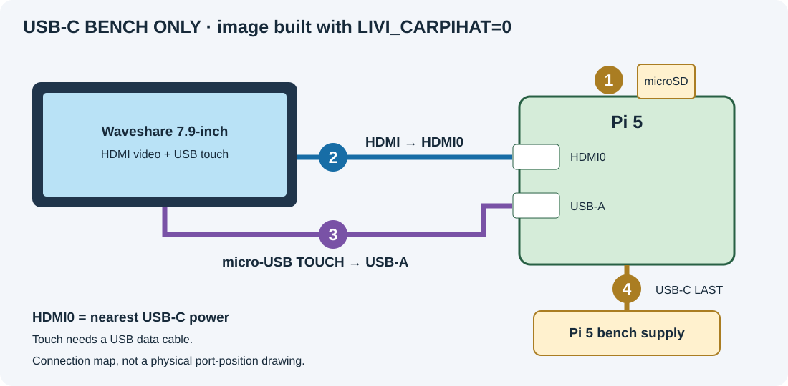
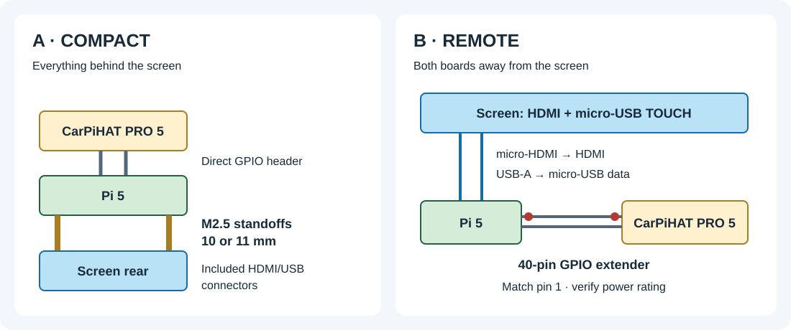
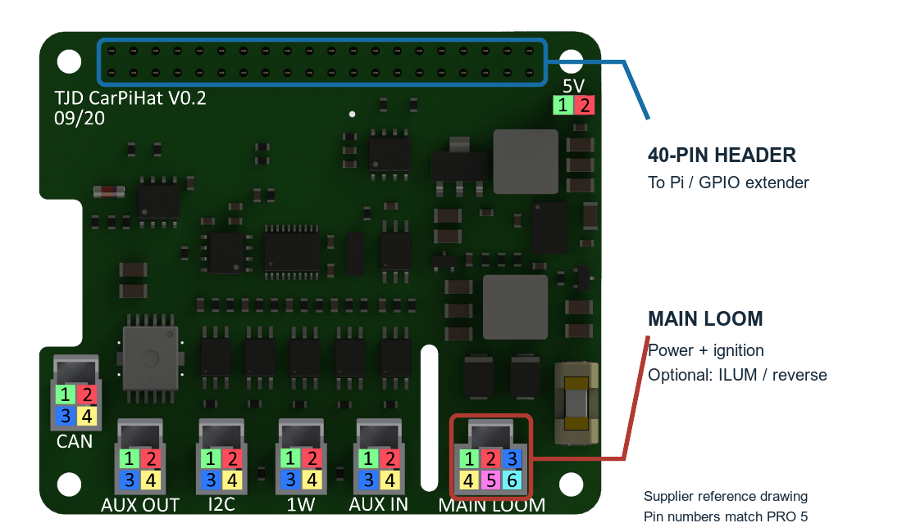
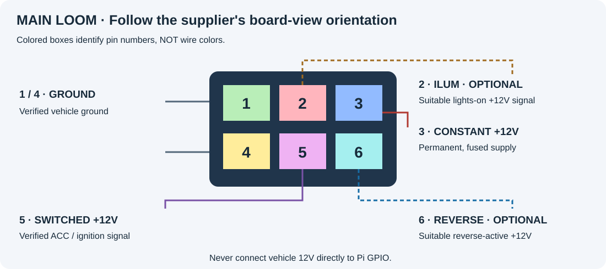
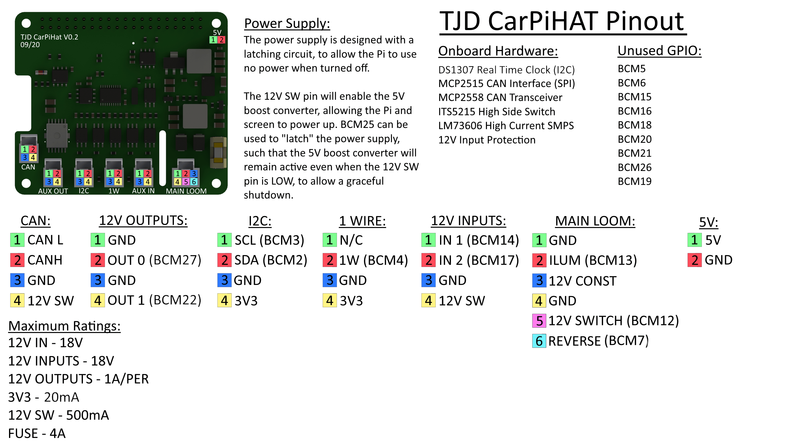

# LIVI Pi 5 quick-start

**Flash the card → connect two screen cables → power on → add your extras.**

Follow steps **1–4**, then choose the optional sections you need.

**Choose your power:** the standard image uses CarPiHAT power and ignition
control. For a USB-C-only bench setup without the HAT, use an image built with
`make pi5 LIVI_CARPIHAT=0`.

## 1 · Lay out your parts

| For everyone | Choose your mounting kit | Optional extras |
| --- | --- | --- |
| Raspberry Pi 5 + CarPiHAT PRO 5 and pigtail (or USB-C-only bench kit) | **A · Compact:** included screen connectors + extra **10 or 11 mm M2.5 standoffs** | Protected vehicle wiring |
| Waveshare 7.9-inch HDMI LCD | **B · Remote:** 40-pin GPIO extender rated for HAT power | Cubilux USB-A → TOSLINK cable |
| microSD card + card reader; 32 GB or larger recommended | **B:** micro-HDMI → HDMI cable | MiniDSP C-DSP 8x12 DL |
| Pi 5 USB-C bench supply; official 27 W recommended | **B:** USB-A → micro-USB **data** cable | Supported LIVI Link dongle |
| | | USB microphone for voice assistant and calls |
| | | [4-way Molex Nano-Fit pigtail](https://thepihut.com/products/4-way-molex-nano-fit-pigtail) for the CarPiHAT CAN connector |
| Small screwdriver + suitable cooling | Matching screws and secure board mounts | |

**Cooling:** PRO 5 includes a shroud/fan. A separate Pi Active Cooler does not
fit under the standard compact HAT stack; use the maker's riser/spacer
arrangement if adding one.

## 2 · Flash the microSD

1. Download **`livi-os-rpi5.img.xz`** and its matching `.sha256` from
   [LIVI OS releases](https://github.com/DrSkunk/livi-os-buildroot/releases).
   Standard builds enable CarPiHAT ignition control. For USB-C-only testing,
   build the bench variant above instead.
2. Verify the download. On macOS, run this in the download folder and compare
   the **64-character hash** with the hash in the `.sha256` file:

   ```sh
   shasum -a 256 livi-os-rpi5.img.xz
   ```

3. Open [Raspberry Pi Imager](https://www.raspberrypi.com/software/) →
   **Use custom** → select the `.img.xz` → select the microSD → **Write**.
   Skip Raspberry Pi OS customization; this is a custom appliance image.
4. Let verification finish, eject the card and insert it into the Pi.

> **Writing erases the selected card.** Check its name and capacity first.
> Do not copy the image onto the card as a normal file.

## 3 · Connect the screen

**Keep power disconnected while connecting cables and mounting the HAT.**



1. **Picture:** Pi **HDMI0** → screen **HDMI**.
   HDMI0 is the micro-HDMI port nearest the Pi's USB-C power socket.
2. **Touch:** Pi **USB-A** → screen **micro-USB TOUCH**.
   Use a data cable, not a charge-only cable.
3. **Power last — choose one:**
   - **CarPiHAT:** fit the HAT using [layout A or B](#choose-your-mounting-layout--a-or-b),
     connect the [main loom](#carpihat--wire-power-and-ignition), then turn ignition on.
   - **USB-C bench image (`LIVI_CARPIHAT=0`):** leave the HAT disconnected
     and plug the bench supply into the Pi's **USB-C** socket.

Use the included short screen connectors for the compact layout, or the
longer cables for the remote layout.

## 4 · Check the first boot

- [ ] LIVI appears after the startup splash.
- [ ] Picture is **1280 × 400 landscape**.
- [ ] Touch works at **all four corners**.

| Problem | First check |
| --- | --- |
| No picture | HDMI0, cable seating and screen power |
| Picture, but no touch | USB cable connected to **TOUCH**, and capable of data |
| Rotated/offset touch | Record the issue; do not add another rotation/calibration |

The image already handles the panel's native 400 × 1280 mode and rotation.
If you have display issues, check whether your screen is an older hardware
revision and consult the [Waveshare display documentation](https://www.waveshare.com/wiki/7.9inch_HDMI_LCD)
for that revision.

## Choose your mounting layout · A or B

Plan the final fit now. **Disconnect power before mounting or changing cables.**



### A · Everything behind the screen

1. Mount the Pi behind the screen with the extra **10 or 11 mm M2.5 standoffs**.
2. Use the included HDMI/USB connectors that fit the Pi 5.
3. Mount the CarPiHAT above the Pi using its supplied hardware; its 40-pin
   socket mates directly with the Pi header.

**Check:** boards do not touch, GPIO pins align fully, and the fan has clearance.
M2.5 is the thread size; 10/11 mm is the standoff length.

### B · Pi and CarPiHAT away from the screen

1. Secure the Pi and CarPiHAT at the remote location.
2. Join them with a **straight-through 40-pin GPIO extender**.
   Match **pin 1 at both ends**.
3. Run **micro-HDMI → HDMI** and **USB-A → micro-USB TOUCH** cables back to
   the screen.

**Check:** the extender is rated for the HAT's power path and cable length;
an ordinary signal ribbon is not automatically suitable. Secure cables so they
cannot pull on the connectors. The screen does **not** connect through GPIO.

## Optional · Add MiniDSP audio

**Pi USB-A → Cubilux → optical TOSLINK IN on MiniDSP**

1. Plug the [Cubilux USB-to-TOSLINK cable](https://www.amazon.ca/Cubilux-Unidirectional-Transmitter-Computer-Surround/dp/B0FNCKYM2J/)
   into a Pi USB-A port.
2. Connect its optical end to **TOSLINK IN** on the
   [MiniDSP C-DSP 8x12 DL](https://www.minidsp.com/products/car-audio-dsp/cdsp-8x12-dl).
3. Select **TOSLINK** on the MiniDSP and the USB audio output in LIVI.
   Start with the amplifier muted/volume low and verify the DSP routing before playback.
4. Optionally connect the MiniDSP's separate **USB control cable** to the Pi
   for `minidsp-rs`. Optical carries audio; this second USB cable is for control.

**Check:** playback reaches the intended outputs.

## Optional · Add a USB microphone

**USB microphone → Pi USB-A · voice replies → your existing audio output**

1. Use a Linux-compatible **USB Audio Class microphone** and plug it into a
   free Pi USB-A port.
2. Mount it near the driver, clear of the fan and ventilation outlets. Secure
   its cable away from pedals, steering mechanisms and airbag deployment areas.
3. In LIVI, open **Settings → Audio → Audio Input** and select the USB
   microphone. Keep **Audio Output** set to your speakers/Cubilux.
4. Connect your phone's projection session and activate its voice assistant.
   Ask a short question and check that it hears you and replies through the
   speakers. Adjust **Settings → Audio → Voice Assistant** for reply volume.

**Check:** test a phone call too. If the microphone is missing from Audio Input,
check its USB connection and reopen the device list. The Cubilux TOSLINK cable
is an output, not a microphone input.

## Optional · Add a LIVI Link dongle

Use the dongle's Wi-Fi/Bluetooth for phone projection instead of the Pi radios.

1. Match the dongle's **actual chipset** to the
   [LIVI Link supported-hardware table](https://github.com/f-io/LIVI/blob/main/LIVI-LINK.md).
   Some listed radio variants do not support Bluetooth.
2. On your **Mac or Linux computer**, download **`livi-link-provision`** for
   your platform from [LIVI releases](https://github.com/f-io/LIVI/releases).
3. Plug the dongle into the computer. Open a terminal in the download folder:

   ```sh
   chmod +x livi-link-provision
   ```

   On macOS, also remove quarantine from this trusted download:

   ```sh
   xattr -d com.apple.quarantine livi-link-provision
   ```

4. **Flash the dongle:**

   ```sh
   ./livi-link-provision
   ```

   Follow the tool's prompts, including any unplug/replug or dongle Wi-Fi
   connection it requests. The tool probes the hardware and takes a backup
   before writing. **Do not unplug or remove power while firmware is being
   written.**
5. Keep the stock-firmware backup somewhere safe:
   - **macOS:** `~/Library/Application Support/LIVI/backup/dongle-backup/`
   - **Linux:** `~/.local/share/LIVI/dongle-backup/`
6. After the tool finishes, connect to the dongle over USB or its Wi-Fi and
   open [livi-link.local](http://livi-link.local/) (or
   [10.10.10.1](http://10.10.10.1/)) to check that LIVI Link is running.
7. Move the dongle to the Pi's USB port, select its interfaces in LIVI and
   pair your phone. For later dongle updates, use the web interface's
   **Firmware → Check → Update**; keep power connected until it finishes.

**Buying note:** the [CPC200-CCPA Canadian listing](https://www.amazon.ca/dp/B0CZ3RXM7Q)
does not establish LIVI Link flash compatibility. No Canadian retail unit has
been verified for this guide. Confirm the chipset before buying or flashing.
Phone sessions remain untested on this image; native CarPlay is outside its
current acceptance scope.

## CarPiHAT · Wire power and ignition

**Ignition ON → boot · OFF for 10 seconds → orderly shutdown → power cut.**

CarPiHAT control is enabled by default on Pi 4 and Pi 5. Ignition returning
within the ten-second countdown cancels shutdown. Once shutdown starts, let it
finish; an off/on ignition cycle may be needed to start again.

**Find the connector first:** use the highlighted **MAIN LOOM**, not CAN or AUX.



**Then match the pin numbers:**



| Connect this vehicle circuit | To CarPiHAT **MAIN LOOM** |
| --- | --- |
| Ground | **1 / 4 · GND** |
| Permanent +12V through correctly sized branch protection | **3 · 12V CONST** |
| Switched ACC/ignition +12V | **5 · 12V SWITCH** |
| Optional lights-on +12V signal | **2 · ILUM** |
| Optional reverse-active +12V signal | **6 · REVERSE** |

1. Have the installer identify permanent power, ground and switched ACC/IGN
   using the vehicle diagram and measurements.
2. With the circuit isolated, connect the protected feeds to the pigtail as
   shown. Match the connector orientation, **not wire colors**.
3. Leave unused illumination/reverse wires disconnected and insulated.
4. Turn ignition on: LIVI should boot. Turn it off: after **10 seconds**,
   shutdown should start and the HAT should then cut power.
5. Repeat with ignition off for **less than 10 seconds**, then on: LIVI
   should stay running.

**Never connect vehicle 12V to Pi GPIO. Never use HAT power and USB-C power
together.** Keep permanent power separate from ACC so shutdown can finish.
Size wiring/fuses for the actual circuit, load and cable length.

For the **1990 R129**, the ACC wire is not yet identified. Ask the installer
to check **30** (permanent +), **31** (ground), and a suitable **15R/15**
accessory/ignition circuit. These are circuit names, not connector pins.
Measure OFF/ACC/ON/START behavior, including any drop during cranking.

### Optional · Illumination and reverse

- **ILUM, pin 2:** use a suitable lights-on +12V signal, not an unverified
  dimmer/PWM output. The HAT provides conditioned **BCM13** sensing.
- **REVERSE, pin 6:** use a suitable reverse-active +12V signal. Check
  compatibility with the vehicle's lamp-monitoring circuit. The HAT provides
  conditioned **BCM7** sensing.

These are **sense inputs**, not camera power or video connections. Wiring
alone does not enable dimming or camera switching; GPIO software integration
is still required. **BCM7 conflicts with SPI0 CS1**: resolve this before
combining reverse sensing with SPI/CAN.

### Supplier pinout · keep this beside you



Original and annotated board images: TJD CarPiHAT, copied/adapted from the
[supplier drawing](https://cdn.shopify.com/s/files/1/0176/3274/files/Datasheet_latest.png?v=1647017344).
The [PRO 5 product page](https://thepihut.com/products/carpihat-pro-5-car-interface-dac-for-raspberry-pi-5)
confirms the pinout is unchanged; ignore the version number.

<details>
<summary>Commissioning checks for the installer</summary>

- BCM12 senses ignition; BCM25 controls the power latch through the HAT.
- Firmware asserts BCM25 at startup; the kernel holds it until final poweroff.
  Stopping or restarting the ignition service does not release the latch.
- Check the service with `systemctl status livi-carpihat-power` and
  `journalctl -u livi-carpihat-power`.
- Test key-off during boot, normal key-off, brief supply interruptions,
  ignition returning during shutdown and restart. A black screen is not proof
  of shutdown or power removal.
- Check lighting across the dimmer range; check reverse with the vehicle
  secured, engine off, without moving it.
- Use a suitable interface if a vehicle signal does not meet the HAT input
  requirements. Do not tap unknown, airbag or ECU-sensor wiring.
- The software has automated tests; this Pi 5 assembly still needs these
  physical power-cycle checks before vehicle use.

</details>

## Optional · Haltech CAN telemetry

**Cable:** use the [4-way Molex Nano-Fit pigtail](https://thepihut.com/products/4-way-molex-nano-fit-pigtail)
to connect to the CarPiHAT's **CAN** socket, not MAIN LOOM or AUX. Identify
CAN-H, CAN-L and ground using the supplier pinout above; do not rely on wire
colors.

**Elite 2500 Aux CAN Bus Port → CarPiHAT CAN → `can0` → LIVI**

**No extra custom CAN stream is needed.** LIVI listens to the ECU's standard
broadcast on the Haltech CAN network at **1 Mbit/s**. An extra socket or CAN hub adds
a connection point, not another independent bus.

### 1 · Check the ECU configuration

1. Connect the tuning computer to the **Elite 2500** using the programming
   software appropriate to its installed firmware. Save a backup of the map.
2. In **ESP**, press **F4 → Devices**. Under **Bus Selection / Port**, select
   **Aux CAN Bus Port** for the Haltech devices/broadcast connection. This
   is the ECU's 4-pin Deutsch DTM port, not the CarPiHAT AUX socket.
   Keep the Haltech bus at **1 Mbit/s**.
3. Under **Displays**, enable **Haltech CAN supported dash**. Save/write the
   map and verify it after reconnecting. Confirm the standard broadcast on
   the selected port. **Generic CAN / GCAN is not needed** and is not
   supported on the Elite range.
4. Verify live **RPM** and a correctly calibrated **vehicle-speed channel**
   in the ECU software first. LIVI cannot correct a missing ECU speed source.

**ESP or NSP?** The menu names above are verified against Haltech's
[ESP Devices documentation](https://support.haltech.com/portal/en/kb/articles/devices).
Use the software supported by your installed ECU firmware; NSP layouts can differ.
Do not select an arbitrary third-party dash protocol or add custom GCAN messages.
Leave existing CAN device assignments and sensor calibration unchanged.

### 2 · Connect the CAN branch

With power isolated:

Choose the connection that matches your harness:

- **An available CAN connector on the Haltech:** use its matching connector
  and a short adapter lead directly to the CarPiHAT CAN pigtail. Confirm the
  selected connector carries the Haltech broadcast.
- **A Haltech CAN hub port:** use this only if you need additional sockets.
  A [Haltech 4-port CAN hub, HT-159000](https://www.tunedbyshawn.com/products/ht-159000-elite-can-hub-4-port-dtm-4)
  is one option; a hub is not required for an available direct connection.
- **No spare port:** fit a compatible CAN hub/loom adapter, or have the
  installer make a properly sealed parallel branch in the CAN harness.
  Do not interrupt existing devices or splice sensor leads.

The **4-way Nano-Fit pigtail fits the CarPiHAT end only**. It is not a
ready-made Haltech adapter. The other end needs the connector matching your
actual Haltech harness/hub; four pins alone do not establish compatibility.
Use the [Elite 1500/2500 CAN communications wiring guide](https://support.haltech.com/portal/en/kb/articles/elite-1500-2500-can-communications-wiring-guide)
for the ECU end. Haltech's [Auxiliary CAN Bus Port pinout](https://support.haltech.com/portal/en/kb/articles/auxiliary-can-bus-port-7-4-2020)
specifies pin 1 = +12V, pin 2 = signal ground, pin 3 = CAN-H, pin 4 = CAN-L.
Use its connector-view drawing to identify the cavities, not wire colours.

```text
Elite 2500 · Aux CAN Bus Port (4-pin DTM)
                  │
        matching Haltech adapter lead
        CAN-H / CAN-L twisted + ground
                  │
        4-way Nano-Fit CAN pigtail
                  │
           CarPiHAT CAN → Pi
```

1. Use the exact Elite harness/connector pinout to identify **CAN-H**, **CAN-L**
   and **CAN ground**. Match them to the CarPiHAT supplier pinout; connect
   H → H, L → L and the specified ground reference.
2. Leave any unused pigtail supply wire insulated. **Do not feed the
   Haltech connector's +12V into an unidentified CarPiHAT CAN pin.**
3. Keep H/L twisted and the branch short. There should be **two 120-ohm
   terminators total**, one at each end of the main bus. Check whether the
   HAT adds another terminator before joining an already terminated network.
   With all bus devices unpowered, about **60 ohms across H/L** is the usual
   check for two parallel 120-ohm terminators.

### 3 · Bring up the Pi interface

The interface must appear as **`can0`**, support **1 Mbit/s**, and run
**listen-only**. The PRO 5 oscillator in this build has not been identified:
check its marking or confirm with the supplier before choosing the overlay
clock. The older CarPiHAT guide documents 8 MHz; that is not confirmation of
your PRO 5 revision. An 8 MHz MCP2515 cannot achieve 1 Mbit/s with the Linux
driver; use a suitable 1 Mbit/s listen-only adapter if yours is 8 MHz.
Do not declare a different oscillator in software to work around this.

Build this OS with the confirmed clock, for example
`make pi5 LIVI_CAN_OSCILLATOR=16000000` **only for a physical 16 MHz crystal**.
For a physical 20 MHz crystal use `20000000`. This adds the MCP2515 overlay on
SPI0 CS0, interrupt BCM23, leaving CS1/BCM7 free. The default empty setting
does not enable the HAT CAN controller; it supports a compatible `gs_usb`
USB CAN adapter instead. An actual 8 MHz clock can be selected with `8000000`
for a **verified 500 kbit/s OBD-II** connection, not this 1 Mbit/s V2 route.
Install the updated LIVI AppImage too: an older app still decodes only RPM/speed.

From a root diagnostic shell, once the correct interface exists:

```sh
systemctl restart livi-can.service
ip -details -statistics link show can0
/usr/libexec/livi-can-capture
```

Stop if bring-up fails, the bitrate/listen-only state is wrong, or errors keep
increasing. Do not transmit test frames onto the ECU bus. Persist the verified
configuration in the OS build and check it again after a cold boot.

### 4 · Enable telemetry in LIVI

1. Open **Settings → Car → CAN Telemetry**, choose **Haltech V2** as the
   backend, and turn on **Settings → Car → Enable CAN telemetry**.
2. Check RPM against the ECU software while stationary.
3. Verify speed using suitable test equipment; do not operate the tuning
   computer while driving.

| Receive ID | What LIVI reads | Check |
| --- | --- | --- |
| `0x360` | RPM: first two bytes, big-endian unsigned | `0B B8` = 3,000 RPM |
| `0x370` | Speed: first two bytes, big-endian unsigned ÷ 10 | `03 E8` = 100.0 km/h |
| `0x372` | Battery voltage: bytes 0–1 ÷ 10 | `00 8E` = 14.2 V |
| `0x3E0` | Coolant: bytes 0–1 ÷ 10 − 273.15 | `0E 30` = 90.05 °C |
| `0x361` | Oil pressure: bytes 2–3 ÷ 10 − 101.3 | `13 95` = 400 kPa gauge |
| `0x368` | Wideband sensor 1 lambda: bytes 0–1 ÷ 1000 | `03 E8` = λ 1.000 |
| `0x36A` | Knock 1/2: bytes 0–1 / 2–3 ÷ 100 | `04 D2 09 29` = 12.34 / 23.45 dB |

All multibyte values above are unsigned big-endian. The telemetry keys are
`rpm`, `speedKph`, `batteryV`, `coolantC`, `oilPressureKpa`, `lambda`,
`knock1Db` and `knock2Db`. Dashboard availability depends on the selected
theme; receiving a field does not add a gauge. Lambda is not converted to AFR
without a fuel-specific stoichiometric ratio. Oil/knock/wideband readings need
valid ECU sensor channels. Values become `null` after 1.5 seconds without an
update, or when reception is disabled.

A listen-only Pi does not ACK frames. If this auxiliary bus contains only the
ECU and Pi, a properly configured normal-mode receiver is needed for ACKs.
Terminators do not provide ACKs. Keep LIVI listen-only.

### Alternative · Active OBD-II on the auxiliary Vehicle CAN

This is a different ECU port assignment and protocol, **not** a way to slow
down the Haltech V2 broadcast. Back up the map and identify existing devices
before assigning the auxiliary port to **Vehicle CAN** in ESP and enabling
OBD-II there. The dash checkbox above does not enable OBD-II.

First establish the actual diagnostic bitrate through ESP, Haltech support or
controlled measurements. **Do not assume it is 500 kbit/s.** A physical 8 MHz
MCP2515 works at 500 kbit/s but cannot communicate if the ECU requires 1 Mbit/s.

Once wiring, termination, bitrate and ECU response addressing are validated:

1. Install both the updated OS and LIVI AppImage.
2. Open **Settings → Car → CAN Telemetry** and choose **Haltech OBD-II**.
3. Select the **verified bus bitrate**, then tick the validation acknowledgement.
4. Turn on **Settings → Car → Enable CAN telemetry**.
5. Open **OBD-II status and live values**. Check detected ECU, supported PIDs,
   response age, per-signal state, live values and timeout/error counts.
6. Compare readings to ESP. Turn telemetry off before rewiring or changing
   bus settings; changing the LIVI bitrate requires acknowledging it again.

OBD-II transmits diagnostic requests and uses **normal CAN mode**, unlike
passive V2. Only approved read-only Service 01 requests are allowed. Switching
backends stops the previous worker first; disabling OBD stops requests and
brings `can0` down. Ignition shutdown is unaffected. Oil pressure and knock
levels are not included in this standard OBD-II subset.
See the [detailed Haltech guide](./HALTECH-CAN.md) for adapter selection,
termination and receive diagnostics.

## Photos to finish this guide

The illustrations above are diagrams, not photographs of a completed build.
For annotated assembly photos, collect:

- Screen rear with included connectors and both cable ends visible.
- Compact stack side view showing **10/11 mm M2.5** spacing and fan clearance.
- Remote layout with extender **pin 1** visible at both ends.
- Main-loom pigtail in the same orientation as the supplier drawing.
- Cubilux → MiniDSP optical connection.

## More help

[Waveshare screen](https://www.waveshare.com/wiki/7.9inch_HDMI_LCD) ·
[CarPiHAT quick-start](https://github.com/SamT-J/CarPiHat/wiki/Quick-Start-Guide) ·
[LIVI Link](https://github.com/f-io/LIVI/blob/main/LIVI-LINK.md) ·
[miniDSP-rs supported devices](https://github.com/mrene/minidsp-rs/blob/v0.1.12/README.md)
